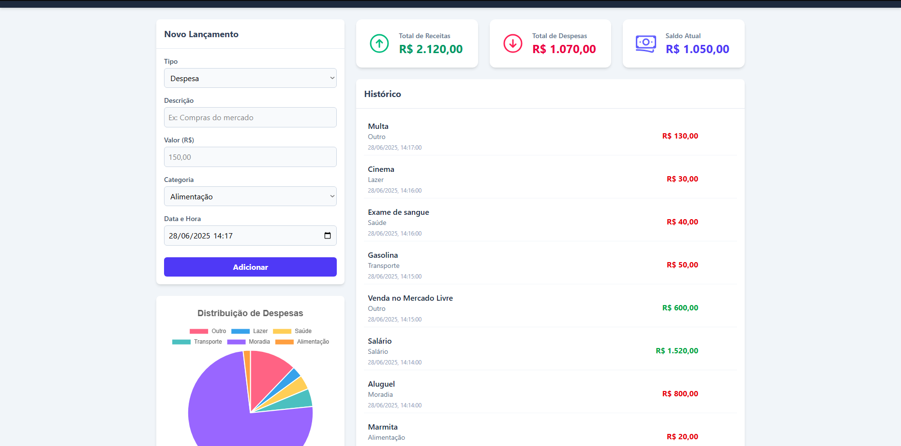

# Dashboard Financeiro Pessoal



Um dashboard moderno e interativo para gerenciamento de finanças pessoais, permitindo ao usuário adicionar, visualizar, editar e excluir transações de receitas e despesas. A aplicação conta com resumos financeiros e visualizações gráficas para uma análise clara dos dados.

---

## 🚀 Funcionalidades

-   **CRUD Completo de Transações:** Adicione, leia, atualize e exclua transações financeiras.
-   **Login por senha única:** acesso pessoal protegido por senha, verificada no backend (sem cadastro, sem login social).
-   **Resumo Financeiro:** Cards de destaque que exibem o total de receitas, despesas e o saldo atual.
-   **Visualização Gráfica:** Um gráfico de pizza interativo que mostra a distribuição de despesas por categoria.
-   **Edição Inteligente:** O formulário principal é reutilizado para adição e edição, pré-preenchendo os dados ao selecionar uma transação para editar.
-   **Design Responsivo:** Interface limpa e funcional, inspirada em dashboards profissionais, que se adapta a diferentes tamanhos de tela.
-   **Alertas Modernos:** Notificações e diálogos de confirmação elegantes com a biblioteca SweetAlert2, melhorando a experiência do usuário.

---

## 🛠️ Tecnologias Utilizadas

Este projeto foi construído utilizando as seguintes tecnologias e bibliotecas do ecossistema front-end moderno:

-   **React.js:** Biblioteca principal para a construção da interface de usuário.
-   **Vite:** Ferramenta de build e servidor de desenvolvimento de alta performance.
-   **Firebase (Firestore):** Utilizado como banco de dados NoSQL em tempo real para armazenar e sincronizar todas as transações.
-   **Tailwind CSS:** Framework CSS utility-first para uma estilização rápida e customizável.
-   **Chart.js (com react-chartjs-2):** Para a criação de gráficos interativos.
-   **SweetAlert2:** Para a criação de alertas e modais elegantes e não intrusivos.
-   **Heroicons:** Biblioteca de ícones SVG de alta qualidade.
-   **Hooks do React:** Uso extensivo de `useState`, `useEffect` e `useMemo` para gerenciamento de estado e lógica do componente.
-   **Vercel Serverless Functions (`/api`):** backend mínimo só para autenticação (sem Next.js).

---

## 🔐 Configuração

Este app é de uso pessoal: login único por senha (sem cadastro, sem OAuth). A senha é verificada no
backend (`/api`) e nunca fica no código do frontend.

### 1. Criar/obter o projeto Firebase

1. Crie (ou abra) um projeto em [console.firebase.google.com](https://console.firebase.google.com).
2. Ative o **Firestore Database**.
3. Em *Configurações do projeto > Geral > Seus apps*, crie um app Web e copie as chaves do SDK.
4. Em *Configurações do projeto > Contas de serviço*, clique em **Gerar nova chave privada** (gera um JSON com `project_id`, `client_email` e `private_key` — usados pelo Admin SDK no backend).

### 2. Variáveis de ambiente

Copie `.env.example` para `.env` (uso local) e preencha:

- `VITE_FIREBASE_*`: as chaves do app Web do passo 1 (não são segredo).
- `FIREBASE_PROJECT_ID` / `FIREBASE_CLIENT_EMAIL` / `FIREBASE_PRIVATE_KEY`: vêm do JSON da Service Account (mantenha as quebras de linha da `private_key`, ou use `\n`).
- `FIREBASE_OWNER_UID`: qualquer string estável (ex.: `owner`). Precisa ser **idêntica** à usada em `firestore.rules`.
- `SESSION_SECRET`: gere com `node -e "console.log(require('crypto').randomBytes(32).toString('hex'))"`.
- `APP_PASSWORD_HASH`: gere com `node scripts/gerar-hash-senha.js "sua senha"` e cole o resultado.

No Vercel, cadastre as mesmas variáveis em *Project Settings > Environment Variables* (Production e Preview). As que **não** começam com `VITE_` nunca chegam ao navegador.

### 3. Publicar as regras do Firestore

Edite `firestore.rules` substituindo `SUBSTITUA_PELO_FIREBASE_OWNER_UID` pelo mesmo valor de `FIREBASE_OWNER_UID`, depois publique com o [Firebase CLI](https://firebase.google.com/docs/cli):

```bash
firebase deploy --only firestore:rules
```

(ou cole o conteúdo do arquivo direto no Console do Firebase, em *Firestore Database > Regras*.)

### 4. Rodar localmente

```bash
npm install
npm install -g vercel   # se ainda não tiver
vercel dev              # roda o Vite e as funções de /api juntos
```

`npm run dev` sozinho só sobe o Vite — as rotas `/api/*` não funcionam sem `vercel dev` (ou um deploy no Vercel).

### 5. Deploy

Conecte o repositório no [Vercel](https://vercel.com/new) normalmente (projeto Vite, zero config) e configure as variáveis de ambiente do passo 2.

---
